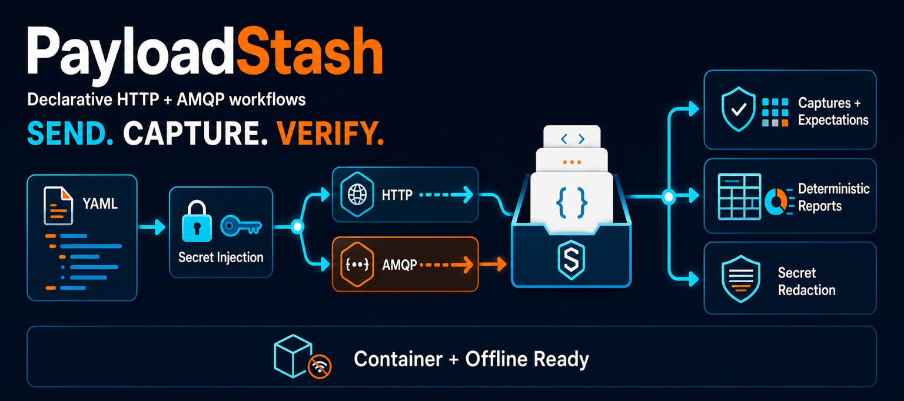

# PayloadStash



PayloadStash is a YAML-driven HTTP and AMQP workflow runner and executable test suite. Define requests and messages as test cases, carry captured values between them, evaluate reusable expectations, and use the final exit status in local or automated test runs. PayloadStash also injects secrets before transport and writes deterministic evidence for every run. Loaded secrets are redacted from resolved configurations and logs, while native, containerized, and offline deployment paths keep the same suite portable.

## User documentation

**Installing, configuring, and operating PayloadStash:**

[:book: Open the PayloadStash user guide](https://ericwastaken.github.io/PayloadStash/)

The GitHub Pages guide is the source of truth for end users, including local/bootstrap, cloned UV, Git-based UV tool, and GHCR Docker installations. User configuration, CLI, examples, output, and troubleshooting details live there rather than in repository READMEs.

## Script hooks for complete test suites

Script hooks let one YAML suite own its setup, requests, assertions, and cleanup. `Hooks.BeforeAll` runs once before any sequence, a sequence-level `Before` runs immediately before that sequence, and `Hooks.AfterAll` runs after the last sequence that ran. Hook output is streamed to the console and recorded in the run log and Markdown report with loaded secrets redacted.

```yaml
StashConfig:
  Name: returning-user
  Hooks:
    BeforeAll:
      - hooks/check-environment.sh
      - { Command: hooks/restart-service.sh, TimeoutSeconds: 120 }
    AfterAll:
      - hooks/collect-logs.sh
  Defaults:
    URLRoot: https://api.example.com
    FlowControl: { DelaySeconds: 0, TimeoutSeconds: 10 }
  Sequences:
    - Name: CreateUser
      Type: Sequential
      Requests:
        - CreateUser:
            Method: POST
            URLPath: /users
            Body: { name: test-user }
            Capture: { userId: body.id }
            Expect:
              - status: 201
    - Name: ReturningVisit
      Type: Sequential
      Before:
        - hooks/clear-cache.sh ${captured:userId}
      Requests:
        - VerifyUser:
            Method: GET
            URLPath: { $pattern: "/users/${captured:userId}" }
            Expect:
              - status: 200
```

Commands run directly, without an implicit shell, from the configuration file's directory. A hook can reference captures from earlier requests, but a missing capture fails before the command starts. `run --dry-run` reports hooks without executing them. Because `payloadstash run` can execute the named programs with the caller's permissions, treat configurations containing hooks as executable code and inspect them before running.

The container image includes `curl`, `jq`, and the Docker CLI for hook scripts. Mounting `/var/run/docker.sock` lets a hook control the host Docker daemon and therefore grants the container broad host authority. Use that mount only with trusted suites. See the detailed [Script hooks guide](https://ericwastaken.github.io/PayloadStash/configuration/hooks/) and [Docker hook guidance](https://ericwastaken.github.io/PayloadStash/install/docker/#script-hooks-in-the-container).

## Source development

### UV workflow

```bash
uv sync
uv run payloadstash --help
```

UV uses `pyproject.toml` and `uv.lock` to create the project environment. Run the CLI directly from the checkout with `uv run payloadstash ...`.

### Bootstrap editable workflow

```bash
python3 bootstrap.py --editable
./payloadstash --help
```

`bootstrap.py` creates a repository-local `.venv`. Editable installs normally need reinstalling only when dependencies or console entry points change.

## Tests

The current test suite uses executable Python scripts rather than a test-runner dependency:

```bash
uv run python tests/test_asserts.py
uv run python tests/test_header_case.py
uv run python tests/test_url_operators.py
uv run python tests/test_amqp.py
uv run python tests/test_hooks.py
```

The AMQP integration harness under `amqp-test/` uses Docker Compose and a real RabbitMQ broker; see [`amqp-test/README.md`](./amqp-test/README.md).

Documentation changes are validated separately:

```bash
python3 -m venv .venv-docs
.venv-docs/bin/python -m pip install -r docs/requirements.txt
.venv-docs/bin/mkdocs build --strict
```

### GitHub Pages maintenance

`.github/workflows/docs.yml` strictly builds documentation pull requests and deploys the `site/` artifact after qualifying pushes to `main`. Generated HTML is never committed.

Before the first deployment, a repository administrator must open **Settings → Pages** and select **GitHub Actions** as the Pages source. The workflow handles later deployments; no `gh-pages` branch is used.

## Architecture

- `payload_stash/main.py` defines the Click CLI and orchestrates validation, execution, and artifact generation.
- `payload_stash/config_schema.py` contains Pydantic configuration models and resolution rules.
- `payload_stash/config_utility.py` resolves operators, captures, JSONPath, and expectations.
- `payload_stash/request_manager.py` performs HTTP work and retry handling.
- `payload_stash/amqp_manager.py` performs AMQP publishing, confirms, TLS, RPC, and subscription waits.
- `config/config-example.yml` is the canonical executable example.
- `docs/` is the sole source for end-user documentation; `mkdocs.yml` defines the published site.

Requests in each sequence execute sequentially or through a bounded concurrent worker pool. Resolution applies YAML parsing, defaults/request/forced precedence, dynamic operators, and secret redaction before transport dispatch. Each run writes a resolved configuration, CSV results, detailed log, Markdown report, and response bodies.

## Build and release entry points

| Command | Purpose |
| --- | --- |
| `./x-python-package-payloadstash.sh` | Build the portable Python distribution archive |
| `./x-docker-build-payloadstash.sh` | Build the local container image |
| `./x-docker-package-payloadstash.sh` | Build the air-gapped Docker distribution archive |
| `./x-payloadstash-version-set.sh` | Update project version metadata |

Artifact-production notes remain in [`packaged-python/README - Python Version.md`](./packaged-python/README%20-%20Python%20Version.md) and [`packaged-docker/README - Docker Version.md`](./packaged-docker/README%20-%20Docker%20Version.md). Publishing a GitHub Release builds, validates, and pushes the corresponding versioned image to `ghcr.io/ericwastaken/payloadstash`; normal commits do not publish containers.

### Publishing a release

Use [`DEVELOPMENT.md`](./DEVELOPMENT.md) for the complete maintainer procedure. In summary, update the version without a `v` prefix, test and commit it to `main`, then publish a GitHub Release whose tag adds the prefix, such as project version `1.3.0` with tag `v1.3.0`. Draft releases do not publish images. Stable releases produce exact, minor, and `latest` GHCR tags; prereleases produce only their exact prerelease tag.

## Repository documentation

- [Release notes](./RELEASE-NOTES-v1.0.0.md)
- [Development and release guide](./DEVELOPMENT.md)
- [Configuration sample maintenance](./config/README.md)
- [Agent documentation ownership rules](./AGENT.MD)
- [License](./LICENSE)
